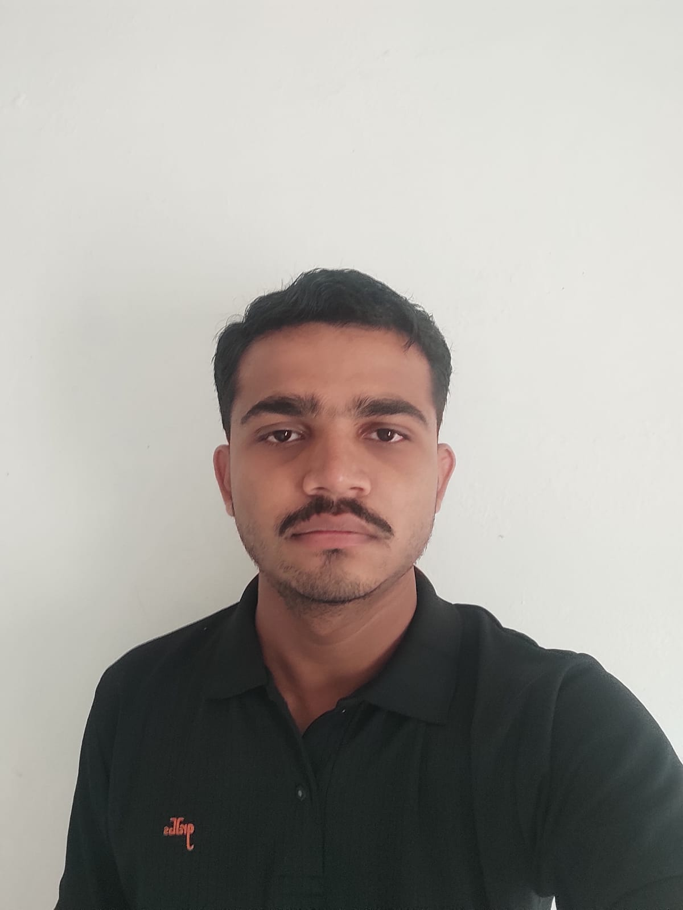

  

  <h1>Nitrajsinh Solanki</h1>
  <h3>Full-Stack Engineer · Product-minded Developer</h3>
  
Gujarat, India &nbsp;·&nbsp; Building thoughtful web and mobile experiences

  

    <a href="https://nitrajsinh-solanki.vercel.app">PORTFOLIO</a>
    &nbsp; / &nbsp;
    <a href="https://github.com/Nitrajsinh-Solanki">GITHUB</a>
    &nbsp; / &nbsp;
    <a href="https://www.linkedin.com/in/nitrajsinh-solanki-647b11293">LINKEDIN</a>
    &nbsp; / &nbsp;
    <a href="mailto:nrsolanki2005@gmail.com">EMAIL</a>
  

  

    
    
    
  

---

## A little about me

I’m a full-stack developer who enjoys turning real-world needs into reliable, well-considered software. I care about the whole experience—not only how a product looks, but also how its interfaces, APIs, data, and everyday workflows fit together.

My work spans **frontend engineering, backend systems, mobile apps, and AI-powered experiences**. I like learning unfamiliar tools, solving problems end to end, and making technical decisions that keep products useful and maintainable.

## What I do

<table>
  <tr>
    <td width="50%" valign="top">
      <strong>01 · Full-stack products</strong> 
      Build responsive interfaces and connect them to clean APIs, data models, authentication, and practical business workflows.
    </td>
    <td width="50%" valign="top">
      <strong>02 · Backend engineering</strong> 
      Design REST APIs and application features with attention to maintainability, access control, and dependable data handling.
    </td>
  </tr>
  <tr>
    <td width="50%" valign="top">
      <strong>03 · Mobile experiences</strong> 
      Develop Flutter apps for Android, including delivery workflows, location-aware features, and push notifications.
    </td>
    <td width="50%" valign="top">
      <strong>04 · Exploring ideas</strong> 
      Experiment with AI integrations, scientific data experiences, blockchain applications, and systems programming.
    </td>
  </tr>
</table>

## The toolkit I work with

  <strong>Languages</strong> 
  
  
  
  
  
  

  <strong>Web & mobile</strong> 
  
  
  
  
  

  <strong>Backend, data & platforms</strong> 
  
  
  
  
  
  

## Where I am now

**Full Stack Engineer Intern · VeloxCore Private Limited**  
*January 2026 – Present*

Building and maintaining web application features with **ASP.NET Core, Angular, C#, and SQL Server**—from REST API design and data work to reusable interface components.

**Education**  
**B.E. in Computer Engineering** · Government Engineering College (GEC), Patan  
Gujarat Technological University · 2022–2026

## A few milestones I’m proud of

| Recognition | Achievement |
|---|---|
| **StackUp Hackathon** | 3rd place · Library & Book Store Inventory System · **$90** |
| **StackUp May 2025 Challenge** | 4th place · BioMap · **$70** |
| **Aptos Bounty Challenge** | NFT Marketplace · **$60 bounty** |
| **StackUp Hackathon** | Moodify · **$20 merit prize** |
| **StackUp Hackathon** | Math Genius AI · **$10 merit prize** |
| **Rust Bounty Challenge** | First submission to complete all objectives |

## Outside the code

I value curiosity, clear communication, thoughtful collaboration, and steady improvement. Whether I’m working on a production feature or exploring a new technology, my goal is the same: understand the problem, build with care, and leave the solution easier to use and maintain.

---

### Have a good problem to solve?

I’d love to connect, learn from other builders, and explore meaningful opportunities.

  <a href="https://nitrajsinh-solanki.vercel.app"><strong>MY PORTFOLIO ↗</strong></a>
  &nbsp; · &nbsp;
  <a href="https://www.linkedin.com/in/nitrajsinh-solanki-647b11293">LINKEDIN</a>
  &nbsp; · &nbsp;
  <a href="https://x.com/Nitrajsinh_S">X</a>
  &nbsp; · &nbsp;
  <a href="https://medium.com/@nrsolanki2005">MEDIUM</a>
  &nbsp; · &nbsp;
  <a href="mailto:nrsolanki2005@gmail.com">EMAIL ME</a>

Thoughtful software. Useful outcomes. Always learning.

