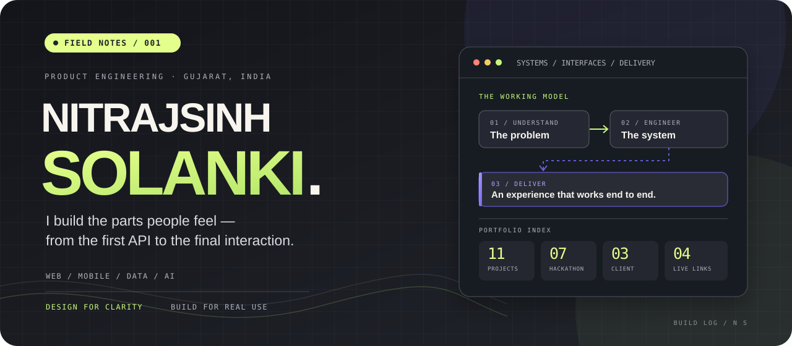
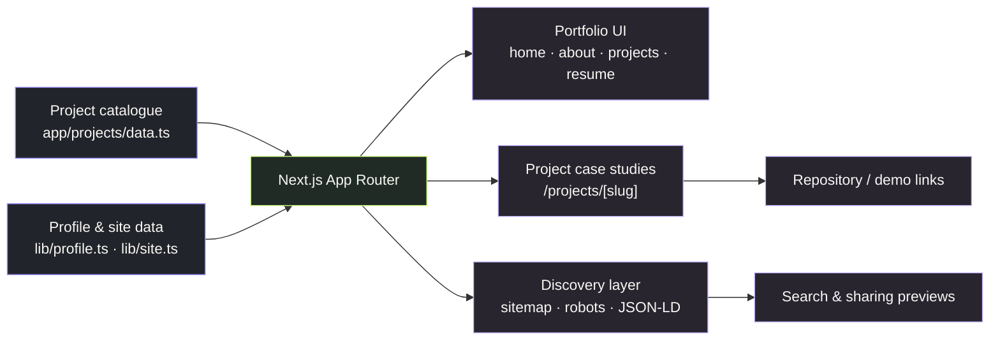

<div align="center">



<p>
  <a href="https://nitrajsinh-solanki.vercel.app"><strong>OPEN THE PORTFOLIO ↗</strong></a>
  &nbsp;&nbsp;·&nbsp;&nbsp;
  <a href="https://nitrajsinh-solanki.vercel.app/projects">EXPLORE THE BUILDS</a>
  &nbsp;&nbsp;·&nbsp;&nbsp;
  <a href="https://nitrajsinh-solanki.vercel.app/resume">VIEW RESUME</a>
</p>

<sub>FULL-STACK ENGINEERING · PRODUCT THINKING · WEB & MOBILE</sub>

</div>

---

## 01 / The point of view

> **Build the full path, not just the screen.**

I’m **Nitrajsinh Solanki**, a full-stack developer from Gujarat, India. I like the seam between what a user sees and what makes it dependable: the interface, the API, the data model, the permissions, the edge cases, and the small details that make a product feel finished.

This repository is the source for my [portfolio site](https://nitrajsinh-solanki.vercel.app) — a living index of projects, engineering experiments, client work, and case studies. It is designed to answer more than *“what did you build?”*: it also explains the problem, the implementation approach, and the outcome.

## 02 / The portfolio, in numbers

<div align="center">
<table>
  <tr>
    <td align="center" width="25%"><strong><code>11</code></strong><br/><sub>PROJECTS INDEXED</sub></td>
    <td align="center" width="25%"><strong><code>07</code></strong><br/><sub>HACKATHON BUILDS</sub></td>
    <td align="center" width="25%"><strong><code>03</code></strong><br/><sub>CLIENT PROJECTS</sub></td>
    <td align="center" width="25%"><strong><code>04</code></strong><br/><sub>LIVE PROJECT LINKS</sub></td>
  </tr>
</table>
</div>

These counts come from the project's own `app/projects/stats.ts` module. They describe the current portfolio catalogue, not vanity counters or GitHub activity.

## 03 / A few builds with a story

The work crosses product UI, data-heavy exploration, AI-assisted workflows, and lower-level systems code. Here are some of the more distinctive entries.

<table>
  <thead>
    <tr>
      <th align="left">Build</th>
      <th align="left">What it does</th>
      <th align="left">Receipt</th>
    </tr>
  </thead>
  <tbody>
    <tr>
      <td><strong><a href="https://github.com/Nitrajsinh-Solanki/library-inventory-system">Library Inventory System</a></strong><br/><sub>Next.js · TypeScript · MongoDB</sub></td>
      <td>Role-aware library workflows: book lifecycle, borrowing, fines, email verification, and optional AI descriptions.</td>
      <td>🏆 <strong>3rd place · $90</strong><br/><sub>StackUp Hackathon</sub></td>
    </tr>
    <tr>
      <td><strong><a href="https://github.com/Nitrajsinh-Solanki/biomap">BioMap</a></strong><br/><sub>TypeScript · Mapping · Public APIs</sub></td>
      <td>A scientific explorer connecting biodiversity maps, chemistry data, environmental monitoring, space media, and educational resources.</td>
      <td>🏆 <strong>4th place · $70</strong><br/><sub>StackUp May 2025 Challenge</sub><br/><a href="https://biomap-nitrajsinh-solankis-projects.vercel.app">Live app ↗</a></td>
    </tr>
    <tr>
      <td><strong><a href="https://github.com/Nitrajsinh-Solanki/aptos4-bounty-nft">Aptos NFT Marketplace</a></strong><br/><sub>Move · Aptos · Smart contracts</sub></td>
      <td>An on-chain marketplace with auctions, royalties, offers, batch transfers, APT payments, and creator tipping.</td>
      <td>◇ <strong>$60 bounty</strong><br/><sub>StackUp Bounty Challenge</sub></td>
    </tr>
    <tr>
      <td><strong><a href="https://github.com/nitrajsinh-solanki/hackathon_may_stackup">Moodify</a></strong><br/><sub>React · AI recommendations · Music APIs</sub></td>
      <td>A music experience that uses context such as location and weather to inform AI-assisted recommendations.</td>
      <td>✳ <strong>$20 merit prize</strong><br/><sub>StackUp Hackathon</sub></td>
    </tr>
    <tr>
      <td><strong><a href="https://github.com/Nitrajsinh-Solanki/simple-file-server">Rust Simple File Server</a></strong><br/><sub>Rust · TCP · HTTP</sub></td>
      <td>A small HTTP file server built directly on TCP streams, with a custom request/response parser rather than a web framework.</td>
      <td>⚙ <strong>Bounty claimed</strong><br/><sub>First submission to complete all objectives</sub></td>
    </tr>
    <tr>
      <td><strong><a href="https://github.com/Nitrajsinh-Solanki/Meeting-Genius">Meeting Insights Generator</a></strong><br/><sub>React · Node.js · Multimodal AI</sub></td>
      <td>An end-to-end workflow from meeting audio transcription to AI summaries, visual highlights, and speech output.</td>
      <td>↗ <strong>Full-stack GenAI pipeline</strong></td>
    </tr>
  </tbody>
</table>

**More in the catalogue:** [Math Genius AI](https://github.com/Nitrajsinh-Solanki/hackathon-feb), [Floris Restaurant & Banquet](https://floris-restaurant.vercel.app), [Ice Saathi](https://www.icesaathi.co.in), plus additional project case studies and links on the [portfolio projects page](https://nitrajsinh-solanki.vercel.app/projects).

## 04 / How the pieces connect

The site keeps project content structured and lets the App Router compose the right experience for each route. Profile information, reusable UI, project case studies, and search metadata have separate homes instead of being tangled into a single page.



### The details I care about

- **Case studies over link dumps.** Project pages have space for the challenge, approach, contribution, outcome, feature list, technologies, and available demos.
- **Fast paths to real content.** Shared page data is structured; the project listing passes a smaller server-derived payload to its client interface.
- **Discoverability as part of engineering.** Canonical metadata, Open Graph images, JSON-LD, sitemap and robots routes are part of the app.
- **Fewer runtime dependencies for decoration.** Technology icons are stored in the repository and served locally.
- **The small experience details.** Responsive layouts, persistent theme preference, typography, motion enhancement, and contact/resume paths make the site usable beyond the first screenshot.

## 05 / Stack, chosen for the work

<div align="center">

[](https://nextjs.org/)
[](https://react.dev/)
[](https://www.typescriptlang.org/)
[](https://tailwindcss.com/)
[](https://vercel.com/)

</div>

| Layer | Tools in this project |
|---|---|
| **Application** | Next.js App Router, React, TypeScript |
| **Styling & type** | Tailwind CSS 4, Syne, DM Sans, DM Mono |
| **Content & schema** | Structured TypeScript data, Metadata API, JSON-LD |
| **Assets & sharing** | Local SVG tech icons, generated Open Graph images, resume PDF |
| **Validation** | ESLint, production build, Python post-build SEO audit |
| **Delivery** | Vercel, GitHub Actions validation workflow |

## 06 / Run it on your machine

The application lives one directory below the repository root.

**Prerequisites:** Node.js 22 and npm.

```bash
# 1. Get the code
git clone https://github.com/Nitrajsinh-Solanki/nitrajsinh-solanki-portfolio.git
cd nitrajsinh-solanki-portfolio/nitrajsinh-solanki

# 2. Install exactly what's in the lockfile
npm ci

# 3. Start the development server
npm run dev
```

Open [http://localhost:3000](http://localhost:3000).

### Optional environment configuration

Copy the example file before adding any environment-specific values:

```bash
cp .env.example .env.local
```

| Variable | Used for |
|---|---|
| `NEXT_PUBLIC_SITE_URL` | Base URL for canonical and absolute URLs; defaults to the portfolio's production domain. |
| `GOOGLE_SITE_VERIFICATION` | Google Search Console verification token, when configured. |
| `BING_SITE_VERIFICATION` | Bing Webmaster verification token, when configured. |

Verification tokens are optional. Add them only after verifying the domain with the relevant service; never commit private credentials.

### Run the quality checks

Run from `nitrajsinh-solanki/`:

```bash
npm run lint
npm run build
python3 scripts/seo-audit.py
```

The SEO audit reads the generated build output, so run it **after** `npm run build`. For automation-friendly output use `python3 scripts/seo-audit.py --json`; use `--strict` to promote warnings to failures. The configured GitHub Actions workflow runs lint, the production build, and the audit.

## 07 / Find your way around

```text
repository/
├── README.md                          # This guide
├── assets/
│   └── portfolio-cover.svg             # Custom README artwork
├── .github/workflows/
│   └── portfolio-validation.yml        # Automated checks
└── nitrajsinh-solanki/
    ├── app/
    │   ├── components/                 # Home sections & shared UI
    │   ├── about/                      # About route
    │   ├── projects/
    │   │   ├── data.ts                 # Source of project content
    │   │   ├── page.tsx                # Project index
    │   │   └── [slug]/page.tsx         # Case-study pages
    │   ├── resume/                     # Resume route
    │   ├── sitemap.ts                  # XML sitemap
    │   ├── robots.ts                   # Robots rules
    │   └── llms.txt/ + llms-full.txt/  # Content discovery routes
    ├── lib/                            # Site, profile & schema utilities
    ├── public/                         # Static assets, icons & resume
    ├── scripts/                        # SEO audit & icon tooling
    ├── package.json
    └── .env.example
```

## 08 / Take the next step

<div align="center">

**A good build makes the complicated feel obvious.**

<a href="https://nitrajsinh-solanki.vercel.app"><strong>SEE THE PORTFOLIO ↗</strong></a>

<br/><br/>

<a href="https://github.com/Nitrajsinh-Solanki">GitHub</a>
&nbsp; · &nbsp;
<a href="https://www.linkedin.com/in/nitrajsinh-solanki-647b11293">LinkedIn</a>
&nbsp; · &nbsp;
<a href="https://x.com/Nitrajsinh_S">X / @Nitrajsinh_S</a>
&nbsp; · &nbsp;
<a href="https://medium.com/@nrsolanki2005">Medium</a>

<sub>Made with intent by Nitrajsinh Solanki · Gujarat, India</sub>

</div>
